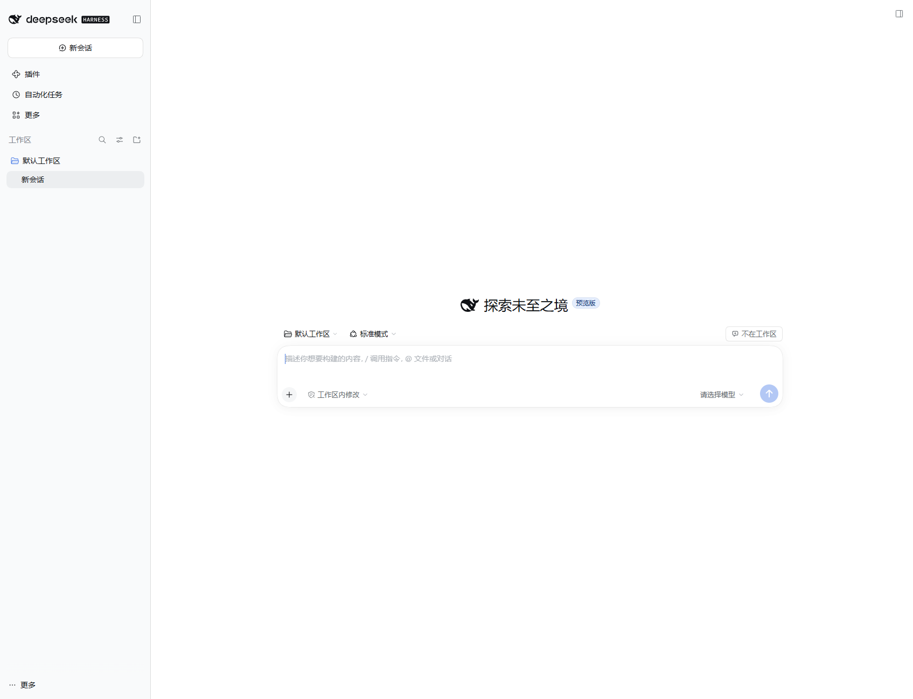
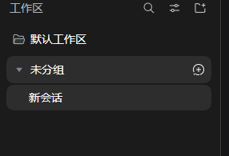
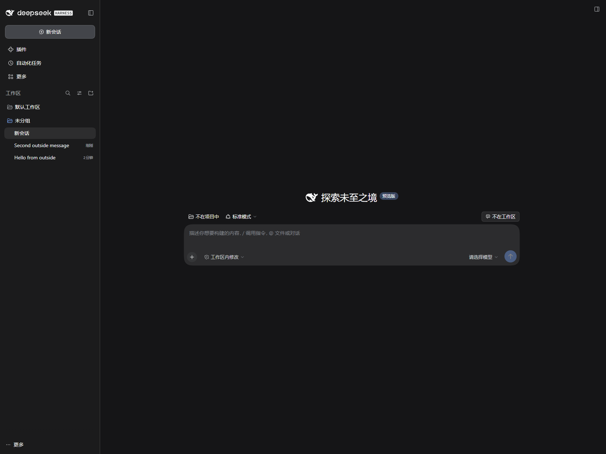
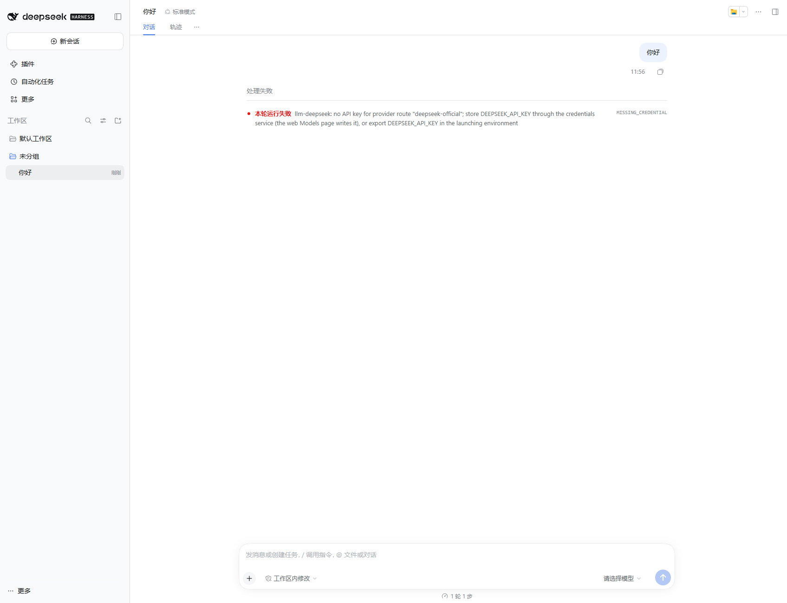

# dsh-plugin-outside-workspace

在 [DeepSeek Harness](https://github.com/deepseek-ai/deepseek-harness)（DSH）里，新建一个**不属于任何已注册工作区**的会话 —— 类似 Codex 的 projectless 会话 / 「不在工作区内工作」。



## 功能

- **入口**：
  - 空白新会话页（hero）工作区选择器右侧的「不在工作区 / Outside workspace」按钮；
  - 侧边栏「未分组 / Ungrouped」分组行右侧的「新会话（＋）」按钮 —— DSH 原生对「未分组」
    分组不处理这个新建按钮（该分组没有 Workspace id），本插件接管它，点击后同样创建一个
    工作区外会话并直接打开；
- **工作目录**：默认落在 Host 的 `<文档>/deepseek-harness/outside-workspace`（缺失时由 Host 递归创建），
  例如 `C:\Users\<你>\Documents\deepseek-harness\outside-workspace`；
- **归属**：会话不注册工作区，侧边栏归入「未分组 / Ungrouped」；
- **首条消息**：DSH 原生在「空白且无工作区」时会禁用输入框，本插件接管 composer，并把工作区外会话的
  新会话页做成与普通新会话页相同的样子 —— 同样的标题、Agent 预设、权限选择、模型选择与发送按钮，
  只把项目名称位置显示为「不在项目中」；首条消息支持添加文件、粘贴图片或拖入附件；Enter 发送 / Shift+Enter 换行。消息被接收后会话不再 blank，
  自动交还宿主的标准对话 UI 和 composer。






## 安装

在任意 DSH 会话里让 agent 使用 `plugin_manager` 工具安装本仓库（需要 Full access 权限）：

```text
plugin_manager({ action: "install_bundle", target: "github:realhenrylan/dsh-plugin-outside-workspace" })
```

也可以从本地目录安装：

```text
plugin_manager({ action: "install_bundle", target: "<本仓库 checkout 的绝对路径>" })
```

安装会写入当前 profile 的 `package.json`（依赖 + `dsh.profile.bundles`）。在开启 HMR 的 Desktop / Web
profile 里新装 bundle 会热生效；如果页面没有出现新按钮，手动刷新一次页面即可。
本地目录安装是 `link:` 安装，profile 的 `node_modules/dsh-outside-workspace` 指向该 checkout。

## 工作原理

- DSH 的 Client Session Controller 的 `ctx.sessions.create({ cwd })` 支持只给工作目录（与 `workspaceId`
  互斥），Host 会递归创建目录并把 `cwd` 记入 SessionHeader —— 所以「工作区外会话」无需改动 Host；
- 插件向宿主 UI 贡献两个 Slot，并接管一个原生控件：
  - `conversation.hero.options`（list）：hero 行里的「不在工作区」按钮，创建会话后
    `ctx.uiWorkspace.openSession(id)` 跳转过去；
  - `conversation.composer`（chain）：仅对「本插件刚创建的、仍为 blank 的」工作区外会话接管 composer。
    接管内容是一个**与普通新会话页同款**的 hero：复用宿主的 hero 布局与控制项（Agent 预设、当前会话的
    权限选择、模型选择），项目选择位（Workspace chip）改为不可点击的「不在项目中」；文本输入用普通
    textarea 顶替宿主的 Lexical 编辑器；图片直接编码，其他文件通过宿主上传服务获取回执，首条消息通过 `ctx.sessions.using(...)` 的
    `binding.session.prompt([...], 'queue')` 发送；
  - 「未分组」分组行的「新会话（＋）」：DSH 原生只在分组带 Workspace id 时才在行内新建会话，
    「未分组」因此点了没反应（无请求、无报错）。插件在 document 捕获阶段识别该行最后一个
    行尾按钮，阻止原生无操作并复用同一个创建工作区外会话的流程；创建失败时用一条顶部提示
    说明原因。该接管只依赖这一处 DOM 形状（`data-row-key="workspace:"` 分组行），形状不符时
    自动放弃、保持原生行为；
- 默认目录推导：若存在宿主 first-use 的默认工作区（`<documents>/deepseek-harness/default-workspace`），
  沿用其 Documents 根（尊重 Host 的 `documentsDirectory` 配置）；否则取 `$host.home/Documents`。
  组合了 native directory picker 时 `directoryPicker/list` 不可用，首次点击会有一条预期的 fallback 警告。

## 已知限制（v1）

- 默认目录固定推导，暂未提供设置项；
- 工作区外会话的首条消息支持文件和图片；`＋` 用于选择附件，slash 指令和 `@` 引用补全从第二条消息起
  （交还宿主 composer 后）可用。图片和附件仍受 DSH 宿主的格式及大小限制；
- 页面刷新后，若仍停留在某个**空白**的工作区外会话，新会话页不会恢复为插件接管版（发过消息的会话不受影响）；
- 工作区外会话的首条消息页复刻了当前 DSH 新会话页的 DOM 与样式（hero 布局类、`conversation.hero.agentPreset` /
  `conversation.input.permission` / `conversation.input.model` 等控制位）。若后续 DSH 版本改动这些结构，
  页面会安全退化（控制项缺失时只是不渲染，不会影响会话创建与发送）；
- 「未分组」分组行的「＋」接管依赖当前 DSH 侧边栏的 DOM：该行是
  `[role="treeitem"][data-row-key="workspace:"]`，新会话按钮是行内最后一个非弹层按钮。
  若后续 DSH 版本改了这个结构，接管会安全失效（按钮保持原生行为，不会再创建会话）；
  若上游之后原生实现了「未分组」新建会话，本插件仍会优先按「工作区外会话」的语义接管该点击；
- 仅面向 Web / Desktop 的 Web 前端（`dsh.client.platform: web`）。

## 卸载

```text
plugin_manager({ action: "remove_bundle", target: "dsh-outside-workspace" })
```

## 仓库结构

| 文件 | 作用 |
|---|---|
| `index.js` | Host 半：空 `apply`，仅让 bundle 行可加载（能力全在浏览器半）。 |
| `client.js` | 浏览器半：hero 入口按钮 + 首条消息 composer 接管 + 会话创建/跳转。 |
| `cordis.patch.yml` | bundle patch，插入 `outside-workspace` 行。 |
| `locale/*.json` | 插件管理页显示用的标题/描述。 |
| `icon.svg` | 插件图标。 |

## License

MIT
